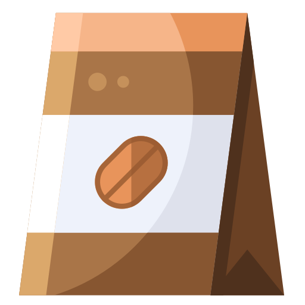
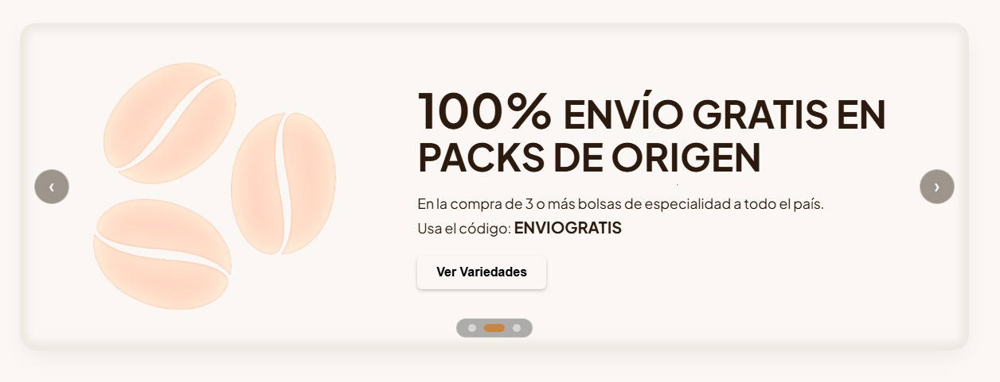
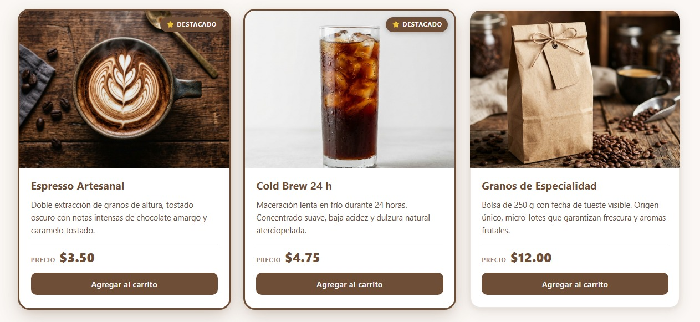
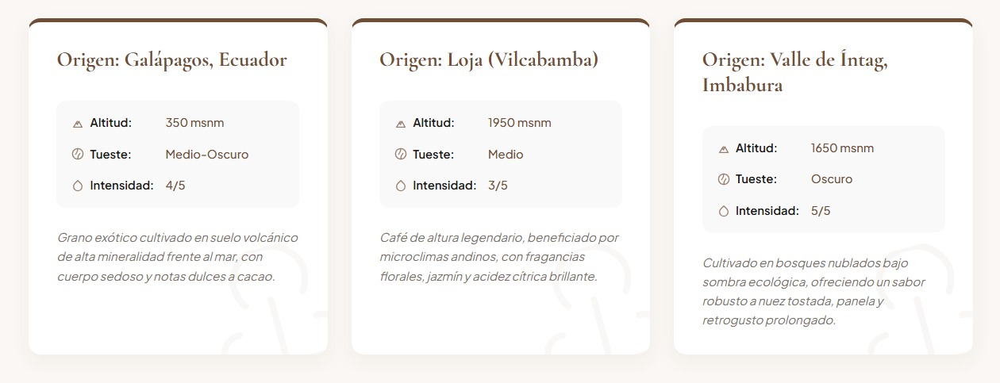
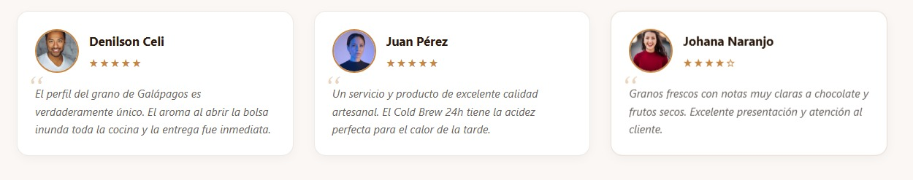

# Café Raíz — Tostado Artesanal

##  1. Propuesta del Emprendimiento

**Café Raíz** es un emprendimiento de café de especialidad y tostado artesanal que conecta directamente a los productores locales de diversas regiones y pisos altitudinales del Ecuador (como Galápagos, Loja e Imbabura) con consumidores apasionados por el café de alta pureza.

### Misión y Enfoque:
- **Tostado en Pequeños Lotes:** Garantizar frescura y notas de cata sobresalientes (chocolate amargo, caramelo, florales y cítricas).
- **Transparencia y Trazabilidad:** Visibilizar el origen, la altitud de cultivo, el perfil de tueste y la intensidad de cada grano mediante fichas técnicas interactivas.
- **Experiencia de Usuario Transparente y Moderna:** Proveer una plataforma digital fluida, limpia y accesible donde los clientes puedan conocer el catálogo, promociones vigentes y testimonios reales.

---

## 2. Integrantes del Equipo

| Integrante | Rol / Componente Principal | Contacto / GitHub |
|---|---|---|
| **Andrés Pozo** | Componente `<tarjeta-producto>` y catálogo | `@andrespozo237-coder` |
| **Denilson Celi** | Componente `<testimonio-cliente>` e integración | `@Shairr` |
| **Farid Hinojoza** | Componente `<banner-promocion>` y diseño complementario | `@FaridHinojoza` |
| **Fernando Camatón** | Componente `<ficha-origen>` y especificaciones | `@Rarexz08` |

---

##  3. Paleta de Colores y Tokens de Diseño

La identidad visual de **Café Raíz** se construye a través de una paleta cálida, sobria y artesanal basada en el grano tostado, la madera y la crema natural:

| Variable CSS | Valor Hex / Fallback | Muestra | Descripción / Uso en la plantilla |
|---|---|---|---|
| `--color-marca` | `#6f4e37` | `■` Marrón Tostado Café | Color de identidad principal. Presente en navbar, bordes principales, encabezados de tarjetas, insignias, botones y precios destacados. |
| `--color-acento` | `#c68642` | `■` Caramelo Dorado | Color secundario y de realce. Usado en botones de llamada a la acción (CTA), bordes de avatares, estrellas de calificación y efectos hover. |
| `--color-fondo` | `#faf7f4` | `■` Crema Suave / Off-White | Fondo general de la página web, otorgando calidez y un descanso visual orgánico. |
| `--color-superficie`| `#ffffff` | `■` Blanco Puro | Fondo de las tarjetas individuales (Shadow DOM) para garantizar contraste nítido y legibilidad. |
| `--color-texto` | `#2c1a0e` | `■` Espresso Oscuro | Color primario para títulos y tipografía base, evitando el negro puro para armonizar con el café. |
| `--color-texto-suave`| `#6a6460` | `■` Ceniza Café | Color para descripciones secundarias, notas técnicas al pie y reseñas de clientes. |

---

##  4. Guía de Uso de los Componentes (`/componentes`)

Todos los componentes son módulos nativos que hacen uso de **Shadow DOM**, **`<template>`** y **Slots**. 

```html
<!-- Importación global -->
<script type="module" src="./app.js"></script>
```

---

### 4.1. `<banner-promocion>`
*Propósito:* Destacar ofertas, porcentajes de descuento y cupones de compra en un banner con degradado y textura.

#### Atributos Observados:
- `descuento`: Porcentaje de descuento numérico (ej. `"20"` → se renderiza `"20% "`).
- `codigo`: Código o cupón promocional a canjear (ej. `"CAFERAIZ2026"`).

#### Slots Disponibles:
- `slot="imagen"`: Imagen o ilustración del producto en promoción (fallback: `./img/coffee-beans.png`).
- `slot="titulo"`: Texto o encabezado de la oferta (fallback: `"Título de la promocion"`).
- `slot="accion"`: Texto del botón de acción / CTA (fallback: `"Texto del botón"`).
- *Slot por defecto (sin nombre)*: Párrafo descriptivo de las condiciones de la promoción.

#### Ejemplo de Uso:
```html
<banner-promocion descuento="20" codigo="CAFERAIZ2026">
  
  <span slot="titulo">DESCUENTO EN TU PRIMER PEDIDO</span>
  <span>Granos molidos entregados directamente en tu puerta.</span>
  <span slot="accion">Explorar Granos</span>
</banner-promocion>
```

---

### 4.2. `<tarjeta-producto>`

*Propósito:* Mostrar productos del catálogo con fotografía, nombre, descripción detallada, precio formateado y botón de compra.

#### Atributos Observados:
- `precio`: Valor numérico o decimal del producto (ej. `"3.50"` → formateado dinámicamente como `"$3.50"`).
- `destacado`: Atributo booleano. Al estar presente, activa el borde dorado de marca y la insignia flotante `⭐ Destacado`.

#### Slots Disponibles:
- `slot="foto"`: Elemento `` del producto con recorte y zoom en hover (fallback: `"Producto sin foto"`).
- `slot="nombre"`: Título o nombre del café (fallback: `"Producto sin nombre"`).
- *Slot por defecto (sin nombre)*: Párrafo con la descripción y notas de cata.

#### Ejemplo de Uso:
```html
<tarjeta-producto id="tarjeta-espresso" precio="3.50" destacado>
  
  <h3 slot="nombre">Espresso Artesanal</h3>
  <p>Doble extracción de granos de altura, tostado oscuro con notas de chocolate amargo.</p>
</tarjeta-producto>
```

---

### 4.3. `<ficha-origen>`

*Propósito:* Ficha técnica para presentar la trazabilidad del grano con íconos SVG vectoriales y marca de agua decorativa.

#### Atributos Observados:
- `altitud`: Altura de cultivo (ej. `"350"` o `"1800"` → agrega automáticamente la unidad `msnm`).
- `tueste`: Tipo o curva de tueste (ej. `"Medio-Oscuro"`, `"Claro"`, `"Italiano"`).
- `intensidad`: Nivel de intensidad o perfil sensorial (ej. `"4/5"` o `"Suave"`).

#### Slots Disponibles:
- `slot="region"`: Título que indica la finca o región de cosecha (fallback: `"Origen: Sin especificar"`).
- *Slot por defecto (sin nombre)*: Notas adicionales de suelo, variedad botánica o proceso de secado.

#### Ejemplo de Uso:
```html
<ficha-origen altitud="350" tueste="Medio-Oscuro" intensidad="4/5">
  <h3 slot="region">Origen: Galápagos, Ecuador</h3>
  <p>Grano exótico cultivado en suelo volcánico frente al mar, con cuerpo sedoso y notas dulces a cacao.</p>
</ficha-origen>
```

---

### 4.4. `<testimonio-cliente>`
 
*Propósito:* Presentar reseñas y validación social con renderizado dinámico de estrellas y comillas tipográficas estilizadas.

#### Atributos Observados:
- `calificacion`: Número entero del 1 al 5. Convierte dinámicamente el valor en estrellas sólidas y vacías (ej. `"4"` → `"★★★★☆"`).

#### Slots Disponibles:
- `slot="img"`: Imagen o avatar circular del cliente (fallback: imagen placeholder de 60px).
- `slot="autor"`: Nombre del cliente o catador (fallback: `"Cliente Anónimo"`).
- `slot="review"` (o slot por defecto): Texto de la opinión o reseña.

#### Ejemplo de Uso:
```html
<testimonio-cliente calificacion="5">
  
  <span slot="autor">Denilson Celi</span>
  <p slot="review">Me gusta mucho el café y la rapidez del servicio.</p>
</testimonio-cliente>
```

---


# Registro de Aportes de los Integrantes:
| Integrante | Qué realizó en este proyecto |
|---|---|
| **Andrés Pozo** | Implementación y diseño del componente `<tarjeta-producto>`, integración del catálogo principal, maquetación de la cuadrícula de productos y documentación de pruebas de reactividad. |
| **Denilson Celi** | Desarrollo del componente `<testimonio-cliente>`, lógica de cálculo de estrellas dinámicas según calificación, unificación de módulos en [app.js] y revisión de integración. |
| **Farid Hinojoza** | Creación del componente `<banner-promocion>`, encapsulado con fondo texturizado SVG y degradados, lógica de cupones/descuentos y diseño de favicons. |
| **Fernando Camatón** | Construcción del componente `<ficha-origen>`, estilización de tablas técnicas con iconografía SVG nativa y parámetros de altitud/tueste/intensidad. |

---

### Registro 5 · Verificación y Pruebas en el Navegador


#### Pruebas de consola ejecutadas:
```javascript
// 1. Modificar precio dinámicamente
document.querySelector("#tarjeta-espresso").setAttribute("precio", "4.25");

// 2. Aplicar estado destacado dinámicamente
document.querySelector("#tarjeta-coldbrew").toggleAttribute("destacado");

// 3. Modificar cupón y descuento del banner
const banner = document.querySelector("banner-promocion");
banner.setAttribute("descuento", "30");
banner.setAttribute("codigo", "ESPE2026");

// 4. Cambiar calificación en testimonios
document.querySelector("testimonio-cliente").setAttribute("calificacion", "4");

// 5. Modificar altitud de la ficha de origen
document.querySelector("ficha-origen").setAttribute("altitud", "3200");
```

---

##  6. Declaración de Uso de Inteligencia Artificial

- **Herramientas utilizadas:** Asistentes de IA basados en modelos avanzados de lenguaje (LLM).
- **Propósito de la consulta:**
  - Apoyo en la estructura base de los Web Components y revisión de buenas prácticas en la manipulación del Shadow DOM.
  - Asistencia en la resolución y depuración de conflictos en branches de Git y sincronización de atributos observados.
  - Optimización de expresiones regulares y estandarización de la documentación Markdown.
- **Validación humana y modificaciones propias:**
  - Todo el código generado o sugerido fue revisado, probado, adaptado e integrado manualmente por los integrantes en el navegador.
  - La paleta cromática, el diseño responsivo, las notas de cata y la lógica de negocio fueron seleccionadas y ajustadas específicamente para la identidad de **Café Raíz**.
